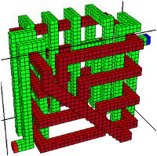
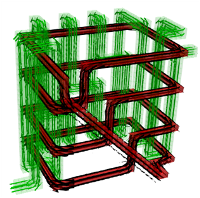
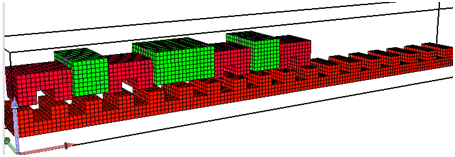
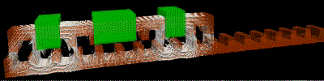
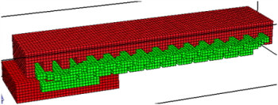
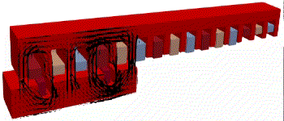

### Calculation of three-dimensional magnetostatics using the equivalent circuit method (ECM).  

&emsp; The results of a study of the equivalent circuit method (ECM) for solving three-dimensional magnetostatic problems are presented. Mathematical formulations, algorithms, and Fortran code are provided.  
&emsp; For research purposes, a simple-to-use tool has been developed for the initial stages of magnetostatic calculations with minimal requirements for the structure's geometry.
The computational space contains field sources—coils of arbitrary geometric configuration and with a specified current density (in the low-frequency range), ferromagnets with a specified magnetic permeability ( nonlinearity B(H) is possible.) and arbitrary geometric configuration. The coils and ferromagnets can move at a specified velocity.

### 1 Calculation method
&emsp; The computational domain is divided into rectangular prismatic cells (a rectangular three-dimensional mesh). The edge of each cell is modeled by a resistive branch. The branch resistance is numerically equal to the magnetic resistance. The resulting electrical circuit is calculated using contour analysis. The sources are the contours emfs, numerically equal to the densities of external current sources in the coils. The resulting currents in the branches are numerically equal to the magnetic flux density in the branches. The matrix of contours resistances and the vector of branches currents are calculated using topological matrices. (This can be considered a variant of the equivalent magnetic circuit method).  Despite the fact that the contours matrix used is overdetermined, the successive overrelaxation (_SOR_) method finds a solution quite quickly (see section [8 Examples](#ex)).  More detailed information is contained in files [Readme.md](./doc/README.md) and [examples.pdf](./examples/examples.pdf)   

### 2 Required Software 
The build and testing was done under _Windows_ (possibly _Linux_ too, but it hasn't been fully tested yet).  
-  [**VoxCad**](https://sourceforge.net/projects/voxcad/files/VoxCAD1000-x64.msi/download), ([here](https://sourceforge.net/projects/voxcad/files/VoxCad0992.tar.gz/download) is a version for  **Linux**) this voxel editor allows you to quickly create 3D images from rectangular parallelepipeds (cuboids). It is well suited for the calculation method under consideration, making it suitable for sketch calculations where precise geometric shapes are often not required. It should also be noted that geometric images in this editor can be accompanied by text data.  
- [**gfortran**](https://www.equation.com/servlet/equation.cmd?fa=fortran) (_equation.com_, with **gcc**). Version 16.2 for Windows was used. _Note_: If you are using _gfortran_ from other sources — for example, from the website _https://winlibs.com_ or _MinGW-w64_ and others, you will need to install the _libz.a_ library and the associated header files.   
- **make**  for build;  
- [**ParaView**](https://www.paraview.org/)  to display calculation results in **vtk** format files.  

### 3. Repository Structure

**/src**: 

* **ECM_MS.f90**   main program; it also contains subroutines for multiplying and transposing sparse matrices, _SOR_ solvers, outputting results to _vtk_ format, etc.
* **m_vxc2data.f90**  module for sharing data obtained when converting data from a **VoxCad** file; 
* **vxc2data.f90**  program for converting data from a **VoxCad** file, _BiCGstab_ solver for calculating the direction of currents in windings;     
* **m_fparser.f90** - parser for calculating functions specified in the lines of a **VoxCad** file. Adapted from source files, available from <http://fparser.sourceforge.net>;  
* **uncompress.cpp**  for create a temporary file with converted uncompressed data into _ASCII_ for later processing;  
* **ini.txt** - a text file in which each line specifies the name of an input data file, including its path; 
* **Makefile**  creating an executable file using **make**;  
* **/courves** - a folder containing text files with data for magnetization curves;  
* **/base64/base64.h** folder with header file for  **uncompress.cpp**.  

**/examples**   

* contains files in **VoxCad** format (with the _.vxc_ extension) with examples of source data.  
* [**Examples.pdf**](./examples/examples.pdf) a brief description of the examples located in this folder.   

**/doc**:   

* [**Quick_guide.pdf**](./doc/Quick_guide.pdf) - quick guide to preparing data for calculations  
* [**Readme.md**](./doc/README.md) - basic mathematical relationships  

### 4. Build  
&emsp; To build the **ECM_MS.exe** executable file, **makefile** is used. Type **make** at the command prompt and run.  

### 5. Launch of calculation  

&emsp;Before starting the calculation, you must configure the contents of the text file **ini.txt**. Each line in this file contains the names of the input data files, including their paths.  
If a line begins with the **$'*'$** character, it is treated as a comment. Consequently, the first line encountered that does not begin with the **$'*'$** character is taken as input for the calculations.  
&emsp;Next run the executable file: **ECM_MS.exe**. As a result, output files will be created: with extensions  **vtk**.   

### 6. Output information
&emsp; The calculation results are written to files with the extension **vtk**. The name of the output folder is specified in the input data (defaults to **/out** if not specified).   
The following sets of files are generated:  
&emsp; **field_i.vtk**  for displaying a 3D field , **src_i.vtk** - for displaying coils,  **fe_i.vtk** - for displaying ferromagnets. The number **i** corresponds to the index of the calculated time point.  
### 7. Review of examples and Quick guide.
 &emsp;  A brief description can be found in the **Quick_guide.pdf** file, located in the **/doc** folder. A brief description of the examples can be found in the **Examples.pdf** file, located in the **/examples** folder.  

### <a id="ex">8. Examples</a>
 &emsp;The examples below are of an exploratory nature, are limited to the calculation of magnetic fluxes and are not related to calculations in the design of industrial machines.

### 8.1 Arbitrary coil geometry and arbitrary magnetic core geometry test
A helix coil wound around a helix magnetic core was used for the tests.
&emsp;Below in  <a id="Fig.1">Fig.1</a> are screenshots taken in  **VoxCAD** (geometry prepared for **ECM_MS**).   Geometry and data for calculation in **ECM_MS** are contained in the file **helices.vxc** in the directory **example**  

  
|&emsp;  | &emsp;&emsp;| 
|  :-:                          |:-:   |
|a) geometry                    |b) magnetic flux density in a ferromagnetic and current density in the coil   | 

&emsp;&emsp;&emsp;&emsp; Fig.1. Screenshots of geometry and result of calculations   
&emsp;&emsp; &emsp;&emsp;Number of unknowns: 189378, computation time: 10s.  

### 8.2 Linear electric machines
&emsp; Linear machines have a simple design that can be easily modeled using cuboids. This allows for the evaluation of mathematical and software solutions by performing calculations for various designs.

### 8.2.1  Linear stepper motor.
&emsp; In this modification of the linear stepper motor, current pulses are applied to windings located on the moving part, creating sequences of magnetic fields that interact with the stationary part of the motor, which has a toothed structure. This results in discrete movement over precisely defined distances—steps.  
Below in  <a id="Fig.2">Fig.2</a> are screenshots taken in  **VoxCAD** (geometry prepared for **ECM_MS**).  The initial data for the task is in the file **step_motor.vxc**.   

|&emsp; |&emsp; | 
|  :-:                       |:-:   |
|a) design    |b) magnetic flux density in ferromagnets displayed in **Paraview** | 

&emsp; Fig.2. Image of stepper motor design and magnetic flux density distribution. Number of unknowns: 184712, сomputation time: 1.25s per time step.  

### 8.2.2. Linear synchronous machine (**LSM**) with longitudinal magnetic flux. 

&emsp;A three-phase winding is placed in a stationary magnetic core and creates a moving magnetic field, first in the positive **x**-axis direction, then in the opposite direction. A direct current is applied to the excitation winding, and it moves synchronously with the field of the three-phase winding. The velocity of the field **Vs** of the three-phase winding is **$2 \cdot \tau\cdot f$**, where **$\tau$** is the pole pitch, **f** is the frequency of the three-phase winding current.  
Below in  <a id="Fig.2">Fig.3</a> are screenshots taken in  **VoxCAD** (geometry prepared for **ECM_MS**).  The initial data for the task is in the file **LSM.vxc**.   

||  |
|  :-:                             |:-: |
| a) design   |b) magnetic flux density in longitudinal section |

&emsp;&emsp; Fig.3. Sscreenshots of geometry created by **VoxCAD** and calculation results  obtained in **ECM_MS** and displayed in **ParaView**.  Number of unknowns: 216988, сomputation time: on average 1.3s per time step.  

 ***
Autor <a href="mailto:JNSresearcher@gmail.com">J.Sochor</a>

 *** 
