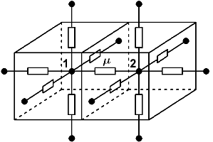
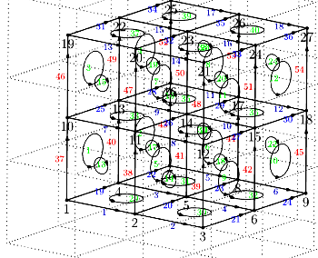

### Basic mathematical relationships

&emsp;The numerical calculation corresponds to the solution of partial differential equations with respect to the magnetic flux density vector **$\vec B$**
<table><tr> 
<td>

$$\nabla\times \left( \frac{1}{\mu_r} \nabla\times\vec{A} \right)  =  \mu_0 \vec{J}_s  &emsp;&emsp;&emsp; (1)$$ 

$$\vec{B} = \nabla\times\vec{A} &emsp;&emsp;&emsp;&emsp; (2)$$
</td>
</tr></table>  

where  **$\mu_0=4\pi\cdot 10^{-7}$** is magnetic constant, **$\mu_r$** relative magnetic permeability,  **$\vec{A}$** is vector potential,  **$\vec{J}_s$**  is density of external current source.  

&emsp;A number of publications (see [Bibliography](#bib)) have shown  that the numerical solution of equation (1),(2)  can be reduced to calculations of the equivalent electrical circuit. The presented work examines the results of the study of this approach.  
 

<a id="eq1">**Equivalent electrical circuit**</a>  
&emsp;The computational domain is divided into rectangular prismatic cells.Within the grid of cells, there is a resistive rectangular computational grid. The nodes of the resistive grid are located at the centers of the cells. The branch resistance of computational grid is numerically equal to the magnetic resistance. The resulting electrical circuit is calculated using contour analysis. The sources are the contours emfs, numerically equal to the densities of external current sources in the coils. The resulting currents in the branches are numerically equal to the magnetic flux density in those branches. The matrix of contours resistances and the vector of branch currents is calculated using topological matrices.  
&emsp;Fig. 1 shows a diagram for two cells, as well as the topological layout of a circuit with a 3×3×3 grid of nodes. [3D](https://jnsresearcher.github.io/viewing-3D-mesh/) tab in in Fig. 1b)  provides a detailed view of the numbering of branches and contours (with features such as rotation, panning, etc.).  

|| | 
|  :-:                         |:-:  |
|a) circuit for two cells|b) topological representation of a 3×3×3 grid of cells (dashed lines)  | 
|         |and a computational grid (solid lines) [**Click here**](https://jnsresearcher.github.io/viewing-3D-mesh/) for interactive viewing 3d mesh   |
&emsp;&emsp;&emsp;&emsp; Fig.1. Equivalent branches and topology of an electrical circuit

&emsp; Magnetic permeance between two nodes, as shown in Fig. 1a, is equal to $\mu$. This permeability can be represented as a half-sum $\mu = (\mu_1 + \mu_2)/2$, where $\mu_1$ is the magnetic permeability of the 1st cell, $\mu_2$ is the magnetic permeability of the 2nd cell. The conductivity of the branch between nodes 1 and 2 will be equal to:
<table><tr> 
<td>
$$Y_{1,2} = (\mu_1+\mu_2)/2 \cdot \mu_0 S/L$$
</td>
</tr></table>  

where $\mu_0$ is the magnetic constant, $S$ is the cross-sectional area between the 1st and 2nd cells, and $L$ is the distance between nodes 1 and 2.  
Resistance between nodes 1 and 2:
<table><tr> 
<td>
$$Z_{1,2} = 1/Y_{1,2} =  2/(\mu_1+\mu_2) \cdot \mu_0 L/S &emsp;&emsp;&emsp; (3)$$
</td>
</tr></table>  

&emsp;**Some topological relations**  

*  **Nx, Ny, Nz** number of cells, respectively, along the **x, y, z** axes  
*  **Nx+1, Ny+1, Nz+1** number of nodes along the **x, y, z** axes respectively  
* Sum of all nodes:  
**Nsum = (Nx+1)\*(Ny+1)\*(Nz+1)**  
* Sum of all branches:  
**Vsum = Nx\*(Ny+1)\*(Nz+1) + (Nx+1)\*Ny\*(Nz+1) + (Nx+1)\*(Ny+1)\*Nz**  
* Sum of all contours:  
**Ksum = Nx\*(Ny+1)\*(Nz+1) + Nx\*(Ny+1)\*Nz +  Nx\*Ny\*(Nz+1)**  
* The following relationships are known for a connected electrical circuit:  
**Vsum = Kindep + (Nsum-1)**, where **Kindep** - number of independent contours,**(Nsum-1)** - number of nodal pairs  
* The number of independent contours: **Kindep = Vsum - (Nsum-1)** After substituting the expressions we have:  
 **Kindep = 2\*Nx\*Ny\*Nz + Ny\*Nz + Nx\*Nz + Nx\*Ny**  
* Difference corresponds to the number of dependent contours: **dK = Ksum - Kindep =  Nx\*Ny\*Nz**  
* For the circuit shown in Fig. 1b : **Nsum = 27; Vsum = 54; Ksum =36; Kindep = 28; dK = 8** 

&emsp;The calculations use a topological contour matrix **$C_{KV}$** reflects the connection of branches into contours. The number of lines is equal to the sum of the number of contours, and the number of columns equals the number of branches. Each row contains +1 or -1 in the columns corresponding to the branch number included in the contour. If the direction of contour traversal coincides with the direction of the branch, then +1 is assigned; otherwise, -1.  

**Important note**. The calculations utilize a total number of contours **Ksum**, which exceeds the number of independent contours **Kindep**. Consequently, the contours resistance matrix contains dependent rows, rendering the system of equations overdetermined. To solve this system, the Successive Over-Relaxation (_SOR_) method (simple or multi-color variant with _OpenMP_).  

&emsp;**General algorithm of calculations:**  

   1. Calculation of the branch impedance matrix **$Z_{VV}$**. This is a diagonal matrix, as the branches contain no controlled sources. Each element of the matrix is ​​calculated using formula (3).  
   2. Formation of a topological matrix **$C_{KV}$** and its transposition: **$C_{VK}$**
   3. Contours matrix calculation:   
   **$Z_{KK} = C_{KV}\cdot Z_{VV} \cdot C_{VK}$**
   4. Formation of the vector of contour sources of emf **$E_K$**
   5. Solution of a system of equations:   
   **$Z_{KK} \cdot I_{K} = E_K$** relative to contours  currents **$I_K$**.
   6. Calculation of currents in branches:  
     **$I_V = C_{VK} \cdot I_{K}$**  
_Note_: All matrices are highly sparse and stored in CSR format.  

For domains with nonlinear ferromagnet’s, the algorithm is supplemented with simple iterations in a loop:  

   1. for each cell of the ferromagnetic domain, the current amplitude is calculated  **$Im = \sqrt(I_{Vx}^2 + I_{Vy}^2 + I_{Vz}^2)$** it is equal to the induction flux density **B** in the cell
  2. according to the table data **B-H** or **B-μ**, the magnetic permeability **μ** is calculated. The average values ​​**μ_mean** for the volume of the region are also calculated
  3. from this point, there are two possible calculation methods.  
  3.1.  сalculation of the new branch impedance matrix **$Z_{VV}$** for each cell, based on the found **μ**. Under-relaxation is applied to the resistance of each branch (this mode by default).  
  3.2. сalculation of the new branch impedance matrix **$Z_{VV}$** for all cells in the region, based on the calculated mean value **μ_mean** . Under-relaxation is applied to the averaged resistance of the region.  
  4. for both modes the average values ​​**μ_mean** ​​are summed and compared with the average values ​​​​at the previous iteration
  5. if the difference satisfies the convergence criterion, then exit the iteration loop.  
   otherwise, new branch resistances are calculated for each domain **$Z_{VV}$**, contour matrix **$Z_{KK}$**, calculation of the system of equations and calculation of new currents in the branches **$I_V$**  
 transition to 1  
 _Note_: additional iterations are used to protect against false convergence detections.  

<a id="eq2">**Algorithm for calculating current density in coils**</a>  
&emsp; The source of the field is the current carrying conductors. The input data define only the current amplitude (in ampere-turns) as a function of time and the geometric configuration of the conductor. The direction of current in conductors and its density is calculated using the following algorithm.  
&emsp; First, some scalar field is calculated in the coil region using the Laplace equation: **$\nabla^2 V =0$** with Dirichlet boundary conditions at the ends of the current carrying conductor $V_+=+V_0, V_-=-V_0$,  where $+V_0, -V_0$  is the given constants, and the Neumann conditions on the lateral surfaces  $\frac{ \partial V}{\partial n}=0$, &emsp; then the gradient is calculated: $\vec{G} =-\nabla V$, after which the direction cosines are calculated for each cell in the conductor region: $cos_x=\frac{G_x}{|G|}, cos_y=\frac{G_y}{|G|}, cos_z=\frac{G_z}{|G|}$. These values ​​are then multiplied by the time function value obtained from the input data. The algorithm does not automatically calculate the cross-sectional area along the entire length of the conductor. Only the area at the ends of the conductor is calculated automatically. The final current density is obtained by dividing the calculated current by this area.  
&emsp; The input data defines the position of external current sources in cells coordinates, after which these coordinates are converted into contour mesh coordinates.  
  
&emsp;**Note**. Moving ferromagnetic materials and coils simply adds a coordinate recalculation step to the algorithm.  
  
  
***

### <a id="bib">Bibliography</a>

[1]. G. Kron. Diakoptics: the piecewise solution of large-scale systems. Macdonald, London, 1963.    
[2]. Y. D. Save, H. Narayanan, S. B. Patkar, "Solution of Partial Differential Equations by electrical analogy", Journal of Computational Science 2 (2011) 18 – 30.  
[3]. A. Demenko, L. Nowak, W. Szelqg "Reluctance Network Formed by Means of Edge Element Method" SEEE TRANSACTIONS ON MPGNETICS, VOL. 34, NO. 5, SEPTEMBER 1998. 2485-2488  
[4]. J.A.M. Davidson, and M.J. Balchin, "Three-dimensional eddy-current calculation using loop variables to represent magnetic vector potential in conducting regions" IEE PROCEEDINGS, Vol. 131, Pt. A, No. 8, NOVEMBER 1984, 577-583  
[5]. A. Demenko and J. K. Sykulski, “Network equivalents of nodal and edge elements in electromagnetics, ”IEEE Trans. on Magnetics, vol. 38 no. 2, 2002, pp. 1305-08  

***

Autor <a href="mailto:JNSresearcher@gmail.com">J.Sochor</a>  

***
